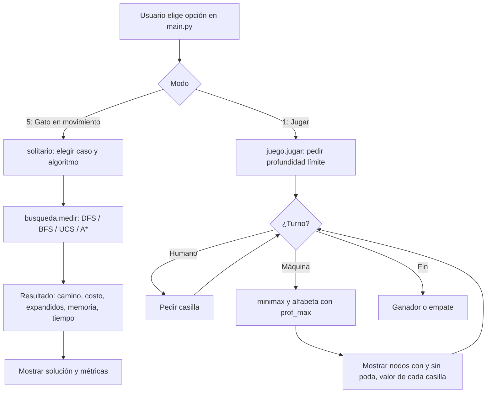
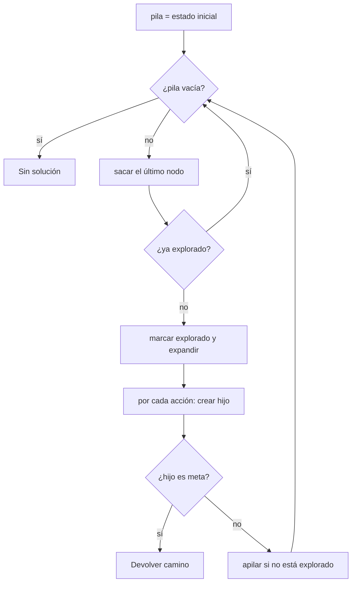
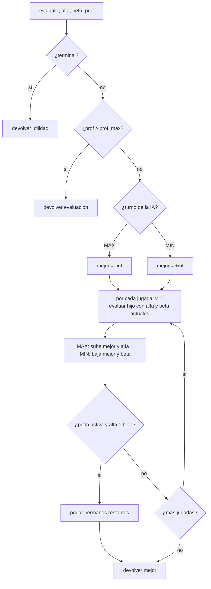

# Gato: algoritmos de búsqueda (borrador del informe)

> Borrador generado con apoyo de IA a partir del código. Las secciones marcadas con **[COMPLETAR]**
> necesitan datos del grupo (portada, capturas, referencias definitivas). Los diagramas están en
> Mermaid (se pueden renderizar en https://mermaid.live y exportar como imagen para el PDF).
> Las tablas con números salen de `python3 -m gato.experimentos` (ver `resultados.md`).

## 1. Portada
**[COMPLETAR]** Proyecto 1 – Algoritmos de Búsqueda · Curso · Integrantes (máx. 3) · Docente · Fecha.

## 2. Introducción
La aplicación resuelve problemas con cinco algoritmos de búsqueda, todos sobre el juego del gato:

- **Gato en movimiento** (un agente): se mueven fichas X sobre el tablero hasta formar una línea, con
  costos de movimiento distintos. Se resuelve con **DFS, BFS, costo uniforme y A\*** (con heurística propia).
- **Gato contra la máquina** (adversario): la máquina decide su jugada con **Minimax y poda alfa-beta**,
  con profundidad límite y función de evaluación.

**Motivación.** El gato es un dominio pequeño que se entiende de inmediato, así que la atención se queda
en los algoritmos. Además permite ver el árbol completo (549.946 nodos) y medir con exactitud cuánto
ahorra la poda. **Objetivos:** modelar un problema como espacio de estados, implementar los cinco
algoritmos sin librerías de búsqueda, diseñar y justificar una heurística, y compararlos con métricas.

## 3. Formulación del problema

### 3.1 Gato en movimiento (un agente)
- **Estado:** `frozenset` con las casillas (0 a N²−1) ocupadas por X. Las O (obstáculos fijos) y el
  tamaño N son constantes de cada caso. Es inmutable y hashable, así que sirve en conjuntos de explorados.
- **Estado inicial:** el de cada caso de prueba (4 casos: 3×3 con 3 fichas, 4×4 con 4 fichas (dos casos), 5×5 con 4 fichas).
- **Acciones:** `(origen, destino)`: mover una X a una casilla vecina (8 direcciones) que no tenga X ni O.
- **Transición:** `(s − {origen}) ∪ {destino}`.
- **Prueba de meta:** las X ocupan exactamente las k casillas de una fila, columna o diagonal sin O.
- **Costos:** paso recto = 2, paso diagonal = 3. Costos distintos para que BFS (menos pasos) y UCS
  (menor costo) puedan dar respuestas diferentes (caso 2: 14 contra 10).

### 3.2 Modo adversario (Gato normal)
- **Jugadores:** X (empieza) y O; la IA es MAX y el rival es MIN.
- **Estados terminales:** alguien completa una línea o el tablero se llena.
- **Utilidad:** gana la IA `10 − profundidad`; gana el rival `profundidad − 10`; empate `0`.
- **Evaluación (corte por profundidad):** ver 6c.

## 4. Arquitectura y diagramas de flujo

### 4.1 Diagrama general


### 4.2 DFS


### 4.3 BFS
```mermaid
flowchart TD
    A[cola = estado inicial; vistos = {inicial}] --> B{¿cola vacía?}
    B -->|sí| Z[Sin solución]
    B -->|no| C[sacar el primer nodo]
    C --> D[por cada acción: crear hijo]
    D --> E{¿hijo en vistos?}
    E -->|sí| D
    E -->|no| G{¿es meta?}
    G -->|sí| OK[Devolver camino]
    G -->|no| H[agregar a vistos y encolar] --> D
    D --> B
```

### 4.4 Costo uniforme y A\*
```mermaid
flowchart TD
    A[heap = (prioridad, nodo inicial)] --> B{¿heap vacío?}
    B -->|sí| Z[Sin solución]
    B -->|no| C[sacar el de menor prioridad]
    C --> D{¿estado ya explorado?}
    D -->|sí, entrada obsoleta| B
    D -->|no| E{¿es meta?}
    E -->|sí| OK[Devolver camino: costo mínimo]
    E -->|no| F[marcar explorado]
    F --> G[por cada acción: crear hijo con g = g_padre + costo]
    G --> H{¿explorado o g no mejora mejor_g?}
    H -->|sí| G
    H -->|no| I[mejor_g = g; push con prioridad] --> G
    G --> B
```
UCS usa `prioridad = g`; A\* usa `prioridad = g + h(estado)`.

### 4.5 Minimax con poda alfa-beta


## 5. Explicación de los algoritmos
Código en `gato/busqueda.py` (búsqueda) y `gato/minimax.py` (adversario). Detalle completo en
`DOCUMENTACION.md` secciones 4, 5 y 10.

| Algoritmo | Frontera | Completo | Óptimo | Tiempo | Espacio |
|---|---|---|---|---|---|
| DFS | pila (LIFO) | sí (con explorados, espacio finito) | no | O(b^m) | O(b·m) en árbol |
| BFS | cola (FIFO) | sí | en pasos | O(b^d) | O(b^d) |
| UCS | cola de prioridad por g | sí | sí, en costo | O(b^(1+C\*/ε)) | O(b^(1+C\*/ε)) |
| A\* | cola de prioridad por g+h | sí | sí si h admisible | depende de h | O(b^d) |
| Minimax (α-β) | recursión | sí (árbol finito) | sí (rival óptimo) | O(b^m) · con poda ideal O(b^(m/2)) | O(b·m) |

**Fragmento clave: alfa-beta** (`_evaluar`):
```python
v = _evaluar(t_hijo, ia, oponente(jugador), prof + 1, alfa, beta, hijo, ctx)
if maximiza:
    if v > mejor: mejor, mejor_mov = v, m
    if mejor > alfa: alfa = mejor          # MAX sube su piso
else:
    if v < mejor: mejor, mejor_mov = v, m
    if mejor < beta: beta = mejor          # MIN baja su techo
if ctx.poda and alfa >= beta:              # ventana vacía: los hermanos no importan
    break
```
**[COMPLETAR]** Agregar el fragmento de `_mejor_primero` (UCS/A\*) y su explicación: la entrada obsoleta del heap y por qué la meta se prueba al sacar.

## 6. Diseño de heurísticas y función de evaluación

### 6a. Heurística de A\* (h1)
Para cada línea posible se asignan las fichas a sus casillas del modo más barato y se toma la mejor línea:
`h1(s) = min_L min_asignación Σ d(ficha, casilla)`, con `d = 3·min(dx,dy) + 2·|dx−dy|` (distancia octil).
Intuición: "el costo mínimo de reorganizar las fichas en una línea si nada estorbara".

**Ejemplo (caso 1, X en 1, 3 y 7):** líneas libres de O: fila superior y columna izquierda.
Fila superior: la ficha 7 debe llegar a 2, `d = 3·1 + 2·1 = 5`. Columna izquierda: la ficha 3 debe llegar a 4, `d = 5`.
`h1 = 5` y el costo óptimo es 5.

**Admisibilidad.** `d` es el costo exacto de una ficha en tablero vacío; los estorbos solo pueden subir el
costo, y cualquier solución debe terminar con las X en alguna línea, así que `h1 ≤ costo real`.
**Consistencia.** Una jugada mueve una ficha con costo `c = d(origen, destino)`. Por la desigualdad
triangular, la distancia de esa ficha a cualquier casilla cambia a lo sumo `c`; entonces cada suma de la
asignación cambia a lo sumo `c` y el mínimo también: `h(s) ≤ c + h(s')`. Verificado por fuerza bruta
en las pruebas (`tests/test_busqueda.py`, todos los estados de los casos 1 a 3).

### 6b. Comparación de heurísticas
Se probó también `h2 = 2 × (casillas de la mejor línea sin X)`: admisible y consistente, pero ignora
distancias. Resultados en `resultados.md` ("Heurísticas de A\*"): en el caso 5×5, UCS expande 8.060 nodos,
A\* con h2 4.176 y A\* con h1 475. **Observación:** h1 cuesta más por nodo (prueba permutaciones), y en tiempo
real A\* con h1 tarda más que UCS en el caso grande (≈ 1,1 s contra 0,13 s). Menos nodos no implica menos tiempo.

### 6c. Función de evaluación de Minimax
`evaluacion(t, ia)` suma, sobre las 8 líneas: +1 / +10 si solo hay una / dos fichas de la IA, −1 / −10 si
son del rival, 0 si están mezcladas; +1 por el centro. Se divide entre 100 para que `|evaluacion| < 1` y
**nunca supere una victoria real** (`≥ 1`). Criterios: líneas abiertas (potencial de ganar o de perder) y
control del centro (es la casilla en más líneas: 4). **Profundidad límite elegida:** **[COMPLETAR]**
(sugerencia: probar 2, 4 y 9 contra una persona y reportar con cuál juega bien sin ser lenta; en el gato
incluso la profundidad 9 es rápida: 0,4 s con Minimax y 0,02 s con poda desde el tablero vacío).

### 6d. Cómo la poda reduce los nodos
Cada nodo hereda `alfa` (piso que MAX ya tiene asegurado) y `beta` (techo que MIN ya tiene asegurado). Si
`alfa ≥ beta`, el padre ya tiene una opción igual o mejor y nunca llegaría a este nodo, así que sus hermanos
restantes se descartan. Ejemplo de la aplicación (posición `XOX/.O./.X.`, mueve O): Minimax evalúa **61** nodos
y alfa-beta **29**, con la misma jugada (casilla 4). Desde el tablero vacío baja de 549.946 a 20.866 (96 %).
El árbol con ramas podadas (`✂`) se ve en la opción 4 del menú. **[COMPLETAR]** capturarlo.

## 7. Evidencias de ejecución
**[COMPLETAR]** Una captura por algoritmo (DFS, BFS, UCS, A\*, Minimax con y sin poda) mostrando entrada,
solución y métricas. Sugerencia: caso 2 para BFS contra UCS (14 contra 10) y el árbol podado de la opción 4.

## 8. Análisis comparativo
Tablas completas en `resultados.md` (regenerar con `python3 -m gato.experimentos`). Resumen (tiempo en
la máquina de desarrollo; en otra máquina cambia):

| Caso | Alg. | Costo | Pasos | Expandidos | Tiempo (ms) |
|---|---|---:|---:|---:|---:|
| 4×4 (caso 2) | DFS | 170 | 75 | 75 | 0,8 |
| | BFS | 14 | 5 | 511 | 5,0 |
| | UCS | 10 | 5 | 684 | 7,5 |
| | A\* | 10 | 5 | 24 | 14,4 |
| 5×5 (caso 4) | DFS | 354 | 154 | 154 | 2,3 |
| | BFS | 17 | 7 | 3.421 | 47,5 |
| | UCS | 17 | 7 | 8.060 | 127,5 |
| | A\* | 17 | 7 | 475 | 1.127,4 |

Discusión: DFS es el que menos expande pero da soluciones larguísimas (170 de costo contra 10); BFS
minimiza pasos pero en el caso 2 no el costo; UCS y A\* dan siempre el costo mínimo y A\* expande 28 a 17 veces
menos nodos que UCS. **Minimax:** nodos con y sin poda para varias profundidades en la última tabla de `resultados.md`
(ahorro de 56 % a profundidad 2 y de 96 % a profundidad 9 desde el tablero vacío).

## 9. Conclusiones
**[COMPLETAR con las ideas del grupo.]** Puntos para considerar: la elección de la estructura de la
frontera determina el comportamiento; sin control de repetidos DFS no termina; la heurística reduce
nodos pero puede costar tiempo; la poda no cambia el resultado, solo el trabajo; el límite de profundidad
cambia la calidad de juego. **Limitaciones:** casos pequeños, sin interfaz gráfica, heurística lenta
(se podría memoizar) y sin ordenar jugadas para mejorar la poda. **Mejoras:** ordenar jugadas, tabla de
transposición, interfaz gráfica, más juegos (Conecta 4).

## 10. Referencias
**[COMPLETAR]** en formato APA o IEEE. Base sugerida:
- Russell, S. y Norvig, P. *Artificial Intelligence: A Modern Approach* (4.ª ed.), Pearson. Capítulos 3 (búsqueda), 4 y 5 (juegos y poda alfa-beta).
- Apuntes y diapositivas del curso.
- Herramienta de apoyo declarada: Claude Code (Anthropic), usada para escribir y documentar parte del código y este borrador. **Declarar el uso real del grupo.**

## 11. Anexos
Manual de usuario: ver `README.md` (instalación, ejecución y menú).
